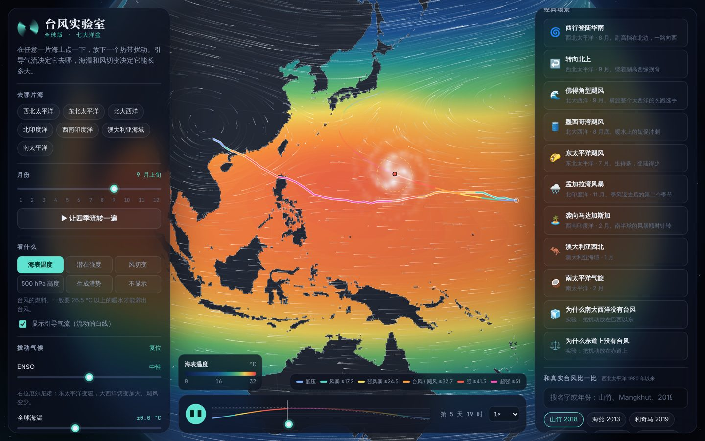
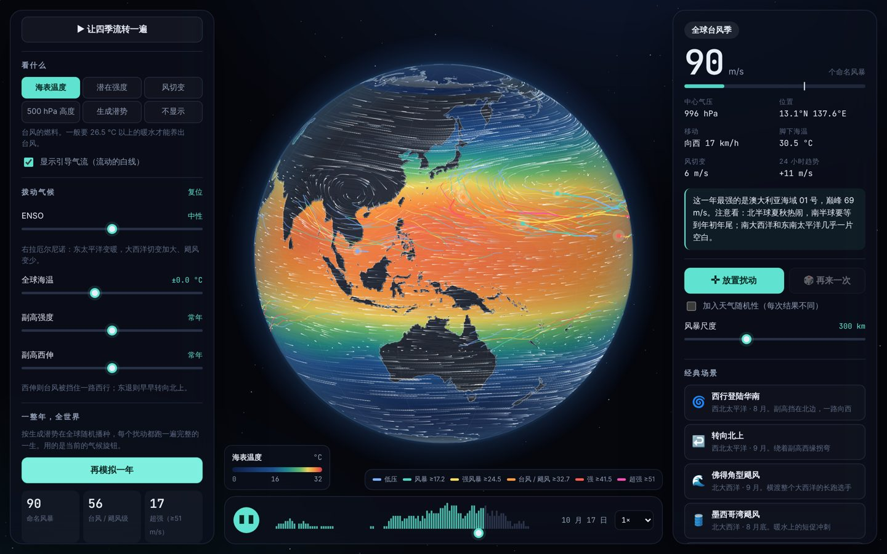

# 台风实验室 · 全球版

在地球上任意一片海放下一个热带扰动，看它被引导气流带去哪里、被海温养成多强。覆盖全球七个洋盆：台风、飓风、气旋风暴都在一个地球上。




## 能做什么

- **放置扰动**：点「放置扰动」，在海面上点一下。风暴的路径、强度、登陆、消散都由当月的环境算出来。
- **看懂为什么**：右侧卡片实时解释此刻是什么在让它变强或变弱（海温、风切变、陆地、离赤道太近……）。
- **五种环境图层**：海表温度、潜在强度、风切变、500 hPa 高度（副高）、生成潜势；流动的白线是引导气流。鼠标悬停看任一点的数值。
- **拨动气候**：ENSO、全球海温、副高强度、副高西伸。改完，当前风暴会立刻按新环境重算。
- **各洋盆各叫各的**：同样 55 m/s，在西北太平洋是「超强台风」，在大西洋是「三级飓风」，在澳大利亚是「五级强烈热带气旋」——按各地气象机构的分级显示。
- **模拟全球一整年**：按生成潜势随机播种，约 90 个风暴各自走完一生，并和各洋盆常年平均对比。
- **和真实台风比一比**：西北太平洋 1980 年以来的 1100 多条真实路径（IBTrACS），从同一地点同一日期出发，看模型和实况差多少。
- **经典场景**：十一个预设，包括两个反例实验——为什么南大西洋和赤道上没有台风。

操作：拖动旋转地球，滚轮或双指缩放，空格播放 / 暂停，Esc 退出放置。

## 运行

纯静态网页，没有构建步骤、没有依赖。因为用了 ES 模块和 `fetch`，要通过网页服务器打开，不能直接双击 `index.html`：

```bash
python3 -m http.server 8080
```

然后打开 <http://localhost:8080>。

### 发布到 GitHub Pages

仓库里带了 `.github/workflows/typhoon-lab-pages.yml`。在仓库 **Settings → Pages → Source** 里选 **GitHub Actions**，之后每次改动 `typhoon-lab/` 并合并到 `main` 都会自动发布。

## 模型是怎么回事（以及它的边界）

**这是帮助理解的概念模型，不是预报，也不是再分析资料。**

气候场（`js/env.js`）是手工搭建的解析近似：纬向结构加上各个著名的区域特征——暖池、赤道冷舌、东边界寒流、各大洋的副热带高压、东亚大槽、季风期北印度洋的强切变等等。引导气流由 500 hPa 高度场按地转关系算出，所以副高南侧自然是东风、西侧自然是偏南风。

风暴（`js/sim.js`）：

- **路径** = 引导气流 + β 漂移（涡旋自己会向极向西漂）。
- **强度**向「环境允许的上限」做逻辑斯蒂增长：上限 = 潜在强度（由海温决定）× 切变折扣 × 赤道附近的自转折扣 × 近岸折扣；登陆后指数衰减；进入 21.5 °C 以下冷水则变性。
- **随机性**（可选）：在气候平均之上叠加缓慢游走的"天气"，同一个种子可以重放。
- **全年模拟**的各洋盆生成率用 `tools/calibrate.mjs` 对着 1991–2020 常年平均校准过。40 个模拟年的平均：

| 洋盆 | 命名风暴 | 常年 |
| --- | --- | --- |
| 西北太平洋 | 24.2 | 26 |
| 东北太平洋 | 17.2 | 17 |
| 北大西洋 | 14.4 | 14 |
| 北印度洋 | 4.8 | 5 |
| 西南印度洋 | 9.4 | 10 |
| 澳大利亚海域 | 10.4 | 10 |
| 南太平洋 | 6.5 | 6 |
| 南大西洋 / 东南太平洋 | 0.0 | ≈0 |

已知的不足：

- 环境只随月份变，风暴一生中环境不随日期推进；没有具体某一天的天气系统，所以和真实个例对比时路径常常差得不少——这正是对比功能想让你看到的。
- 模拟的风暴偏长寿，东太平洋的会一路西行过日界线；孟加拉湾的风暴偏向西行而不是北上。
- 海陆掩膜是 0.25° 网格，小岛和海峡是近似的；陆地没有地形。
- 没有用上一版里的 ERA5 实测气候场——这个版本要覆盖全球，而全球 ERA5 需要另外下载处理（见下）。

想换成真实气候场的话，`makeEnv` 返回的是 1° 全球网格（`sst` `z` `u` `v` `shear` `mpi` `gp`），把这些数组换成 ERA5 月平均即可，其余代码不用动。

## 文件

```
index.html          页面
css/app.css         样式
js/env.js           气候模型：海温、高度场、引导气流、切变、生成潜势
js/sim.js           风暴一生、各洋盆分级、全年模拟
js/globe.js         地球渲染：正射投影、环境场栅格、风场粒子、云系
js/app.js           界面逻辑
data/land.bin       海陆掩膜（Natural Earth 1:50m）
data/coast.json     海岸线
data/wnp.json       西北太平洋历史路径（IBTrACS v04r01，CMA 风速）
tools/              数据构建和校准脚本
test/               模型测试：node --test test/*.test.mjs
```

## 数据来源

- 海岸线和海陆掩膜：[Natural Earth](https://www.naturalearthdata.com/)（公有领域），经 [world-atlas](https://github.com/topojson/world-atlas) 取得。
- 历史路径：[IBTrACS](https://www.ncei.noaa.gov/products/international-best-track-archive) v04r01，NOAA NCEI。
